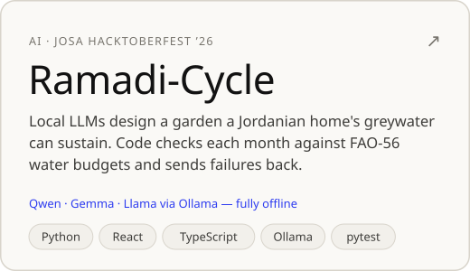
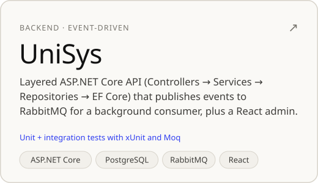
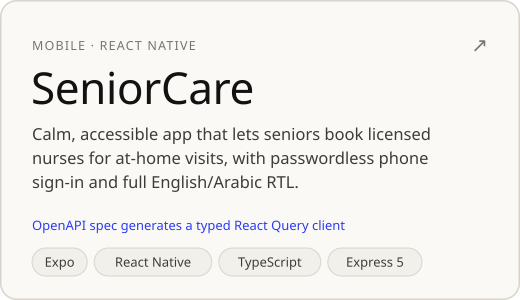

  <a href="https://moh05-a.github.io"><picture>
    <source media="(prefers-color-scheme: dark)" srcset="assets/banner-dark.svg">
    
  </picture></a>

  <a href="https://moh05-a.github.io"><picture><source media="(prefers-color-scheme: dark)" srcset="assets/link-portfolio-dark.svg"></picture></a>
  <a href="https://linkedin.com/in/mohammad-ameerah"><picture><source media="(prefers-color-scheme: dark)" srcset="assets/link-linkedin-dark.svg"></picture></a>
  <a href="mailto:mameerah42@gmail.com"><picture><source media="(prefers-color-scheme: dark)" srcset="assets/link-email-dark.svg"></picture></a>

## About

I'm a software engineer in Amman, finishing a BSc in Computer Science at Princess Sumaya University for Technology (2027). I build products end to end: **ASP.NET Core and PostgreSQL** on the back end, **React and TypeScript** on the front. The parts I care about most are the ones users never see: clean architecture, tests, auth, and data that stays correct.

Lately I've been putting **LLMs into real software**. That means tool calling over scoped, read-only data, code that checks a model's output before anyone sees it, and local open-source models when privacy matters.

- **Most recently:** Software Engineering Intern at **Simplify9** (Jun – Sep 2026), building and testing REST APIs with .NET Core, Entity Framework and PostgreSQL in a production codebase
- **Building:** [Tahona](https://github.com/moh05-a/TahonaOS), a multi-tenant dental clinic platform with an AI assistant and 184 automated tests
- **Certified:** AWS Certified Cloud Practitioner (2025) and AWS Certified AI Practitioner (2026)
- **Languages:** Arabic (native) and English (professional). I build bilingual, right-to-left interfaces
- **Looking for:** junior software engineering roles and internships, backend or full-stack

## Selected work

  <a href="https://github.com/moh05-a/TahonaOS"><picture><source media="(prefers-color-scheme: dark)" srcset="assets/project-tahona-dark.svg"></picture></a> 
  <a href="https://github.com/moh05-a/Ramadi-Cycle"><picture><source media="(prefers-color-scheme: dark)" srcset="assets/project-ramadi-dark.svg"></picture></a>
  <a href="https://github.com/moh05-a/UniSys"><picture><source media="(prefers-color-scheme: dark)" srcset="assets/project-unisys-dark.svg"></picture></a> 
  <a href="https://github.com/moh05-a/hos-trip-planner"><picture><source media="(prefers-color-scheme: dark)" srcset="assets/project-hos-dark.svg"></picture></a>
  <a href="https://github.com/moh05-a/SeniorCare"><picture><source media="(prefers-color-scheme: dark)" srcset="assets/project-seniorcare-dark.svg"></picture></a>

**Try them live:** [Tahona](https://tahona.onrender.com) · [HOS Trip Planner](https://hos-trip-planner-seven.vercel.app) · [BennayaOS](https://bennaya-os.vercel.app)

**Also building:** [BennayaOS](https://github.com/moh05-a/bennayaOS), finance and operations software for small construction contractors. Arabic-first, built with ASP.NET Core 10, EF Core, PostgreSQL and React 19.

## Toolbox

<table>
  <tr>
    <td><b>Languages</b></td>
    <td><picture><source media="(prefers-color-scheme: dark)" srcset="https://skillicons.dev/icons?i=cs,py,ts,js,c,cpp&theme=dark"></picture></td>
  </tr>
  <tr>
    <td><b>Backend</b></td>
    <td><picture><source media="(prefers-color-scheme: dark)" srcset="https://skillicons.dev/icons?i=dotnet,postgres,rabbitmq,django,express,nodejs&theme=dark"></picture></td>
  </tr>
  <tr>
    <td><b>Frontend &amp; mobile</b></td>
    <td><picture><source media="(prefers-color-scheme: dark)" srcset="https://skillicons.dev/icons?i=react,nextjs,tailwind,vite,html,css&theme=dark"></picture></td>
  </tr>
  <tr>
    <td><b>Cloud &amp; DevOps</b></td>
    <td><picture><source media="(prefers-color-scheme: dark)" srcset="https://skillicons.dev/icons?i=aws,docker,linux,git,githubactions,vercel,supabase&theme=dark"></picture></td>
  </tr>
  <tr>
    <td><b>AI &amp; LLMs</b></td>
    <td>
      
      
      
      
      
    </td>
  </tr>
  <tr>
    <td><b>Testing</b></td>
    <td>
      
      
      
    </td>
  </tr>
</table>

**Engineering practice:** clean and multi-tenant architecture · data modeling · event-driven messaging · JWT auth with rotating refresh tokens · audit logging · Docker deployments · CI/CD

## Experience

<picture>
  <source media="(prefers-color-scheme: dark)" srcset="assets/timeline-dark.svg">
  
</picture>

**Software Engineering Intern · Simplify9**  
Amman, Jordan · Jun – Sep 2026

- Developed and tested RESTful APIs and backend services with .NET / .NET Core and Entity Framework
- Designed data models and endpoints, with PostgreSQL for persistence
- Worked inside an existing production codebase, following code review and version control practices
- Turned requirements into working backend features together with the team

**BSc Computer Science · Princess Sumaya University for Technology (PSUT)**  
Amman, Jordan · expected 2027

## Let's talk

I'm looking for junior and internship roles in backend or full-stack engineering. Email is the fastest way to reach me: **[mameerah42@gmail.com](mailto:mameerah42@gmail.com)**. You can also find me on [LinkedIn](https://linkedin.com/in/mohammad-ameerah) or browse my [portfolio](https://moh05-a.github.io).
